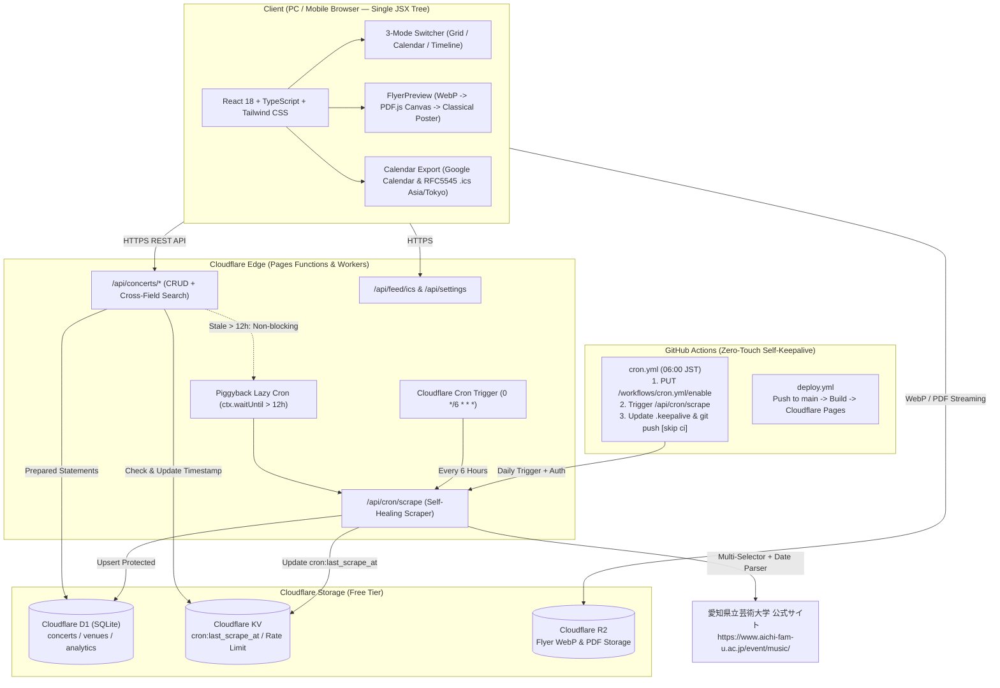

# 🎵 Crescendo（クレッシェンド）— Ken-Gei Prelude

> 若き音楽家たちの響きを、あなたの手のひらに。

愛知県立芸術大学 音楽学部の演奏会情報ポータルサイト。
演奏会の掲載・閲覧・検索・共有・カレンダー連携を誰でも完全無料で利用できます。

🌐 **サイト**: https://ken-gei-prelude.pages.dev

---

## ✨ システム概要 & コア機能

- **完全無料・ゼロメンテナンス運用** — Cloudflare 無料枠（Pages / Functions / D1 / R2 / KV）と GitHub Actions 自己延命機構のみで永久自律稼働（月間費用 ¥0・管理者作業ゼロ）
- **文字見切れゼロ（Zero-Truncation）& Single JSX Tree レスポンシブ設計** — PC（1440px〜2560px）とスマートフォン（320px〜375px）で同一の JSX ツリー・100% 同一の情報量を表示。タイトル・日時・会場・出演者・曲目・料金の省略（`...`）を撤廃し、`clamp()` 流体タイポグラフィと `overflow-wrap: anywhere` で美しい日本語組版を実現
- **3モード・カレンダー & ビュースイッチャー (`?view=grid|calendar|timeline`)** — カードグリッド・月間カレンダー・時系列タイムラインを URL クエリパラメータ連動でシームレスに切り替え。スマホでもドット省略せず公演タイトルチップを直接描画し、タップでインライン詳細ドロワーを展開
- **3段階ハイブリッド PDF / フライヤー描画 (`FlyerPreview`)** — ネイティブ `<iframe>` / `<embed>` / `<object>` 直読みによるモバイルの「空枠バグ」を根治：
  1. **第1優先（WebP高速表示）**: アスペクト比 `1 / 1.414`（A4比率）コンテナ + Skeleton プレースホルダー（CLS ゼロ）+ `fetchPriority="high"` で表裏を高速描画
  2. **第2優先（PDF.js Canvas レンダリング）**: `pdfjs-dist` によりブラウザ `<canvas>` へ1ページ目（表面）・2ページ目（裏面）を高精細描画
  3. **第3優先（クラシック音楽風タイポグラフィ・ポスターカード）**: フライヤー未登録時も公演タイトル・日時・会場をあしらったポスターカードを自動生成
  - 表面/裏面ワンタップ切替、ネイティブ `<dialog closedby="any">` 拡大ライトボックス、「📄 公式PDFを別タブで開く」「📥 PDFを保存」アクションバーを PC・スマホ共通で搭載
- **ワンタップ Google カレンダー & 標準 `.ics` 登録** — `Asia/Tokyo` (`+0900`) `VTIMEZONE` 明記の RFC 5545 準拠 `.ics` 生成と Google カレンダー URL に、開場時刻・会場住所・プログラム・出演者・公式リンク・元ページ URL を自動格納
- **リアルタイム開催ステータスバッジ & スマート会場ナビ** — JST（日本標準時）基準で `🔴 本日開催` / `🟡 明日開催` / `🟢 今週末` / `🎫 入場無料` / `📦 終演アーカイブ` を自動付与。学内ホール（奏楽堂・室内楽ホール・講堂）や主要ホール（芸文・しらかわ・宗次・電気文化会館・長久手文化の家）の住所・Google マップ経路・リニモ「芸大通駅」/ 名鉄バス案内をワンタップ表示
- **インクリメンタル・スマート検索** — 作曲家名・楽器名・会場名・出演者・曲目・タイトルを横断してリアルタイムに絞り込み、ヒット件数を即座に表示
- **演奏者のための音楽楽語辞典 (`/dictionary` & `/dictionary/:slug`)** — 速度標語・速度変化・強弱・イタリア語発想標語・ドイツ語指示語（マーラー/ブラームス等）・フランス語指示語（ドビュッシー/ラヴェル等）・弦管鍵盤専門奏法・略語・楽式理論まで **469語** を収録。ウムラウト展開（`maessig` → `Mäßig`、`drangend` → `Drängend`）・アクサン除去（`cedez` → `Cédez`）・略語（`G.P.` / `rit.` / `l.v.` / `m.d.`）・日本語ニュアンス逆引き（「急き立てる」「駒の近く」「弱音器」等）による 0ms 即時検索、「似た楽語の使い分け」比較カード、Web Audio テンポパルス試聴、マイ単語帳保存・ディープリンク共有を搭載
- **音大生・演奏家プロフェッショナルツール 5種 (`/tools?tool=...`)**：
  1. **純正律ハーモニードローン & 基準音ジェネレーター (`?tool=drone`)**: $A = 415 \sim 444\text{Hz}$（$\pm 0.1\text{Hz}$ 微調整）、開放弦プリセット、純正完全5度（$3:2$）・純正長3度（$5:4$）・純正短3度（$6:5$）・長三和音（$4:5:6$）と平均律の比較同時再生、チェロ/オルガン倍音合成音色
  2. **Web Audio ハードウェアクロック・メトロノーム (`?tool=metronome`)**: `AudioContext.currentTime` 先読みスケジューラ（ジッターゼロ）、$5/4 \cdot 7/8$ 変拍子対応、サイレント小節（3小節再生＋1小節無音等）・裏拍（2・4拍目のみ）トレーニングモード、楽語連動テンポセレクター
  3. **プログラム尺＆進行表シミュレーター (`?tool=timer`)**: 実技試験・リサイタルの純演奏時間計算（規定時間オーバー判定付き）と、開場・開演・曲間転換・休憩を加味した秒単位のステージ進行表生成・Markdown出力
  4. **オーケストラ編成＆パート譜製本計算機 (`?tool=librarian`)**: 弦5部プルト人数からの必要パート譜部数・譜面台・椅子算出、およびPDFページ数からのA3二つ折り（中綴じ）必要枚数・空白ページ・譜めくり回数計算
  5. **演奏会プロデューサー・チェックリスト (`?tool=producer`)**: 公演条件スイッチ連動で6ヶ月前〜終演後精算までのタスクを自動抽出・LocalStorage保存
- **スマート原稿パーサー & イレギュラー完全対応の編集・登録画面 (`/upload`)** — チラシ原稿やメール文面のコピペから日付・時刻・会場・料金・曲目を正規表現で一括自動抽出。延期・中止・内容一部変更・満席の開催ステータスバッジ、1日2回公演（マチネ・ソワレ）・開演時間未定、学内＆県内主要15ホールのワンタップ自動補完、リアルタイム・デュアルプレビュー、自動下書き保存を搭載
- **検索フィルタ付き実用 Q&A (`/faq` & `/docs#faq`)** — 来場者向け・企画者向け・会場アクセス（公共交通機関案内）＆鑑賞マナー・辞典＆ツール仕様の4カテゴリ・全18問のアコーディオンUI（ブラウザ内検索 `hidden="until-found"` 相当の `<details>` 自動展開対応）

---

## 🏗️ システムアーキテクチャ (Mermaid)



---

## 🛡️ Zero-Touch Persistence（管理者作業ゼロの3重自律永続化機構）

管理者が手動でワークフローを再有効化したり、Secrets を再設定したりする必要を完全に排除するため、以下の **3層の自律延命・自己修復アーキテクチャ** を実装しています。

1. **第1層：GitHub Actions 自己延命 (`Self-Keepalive`)**
   - [`.github/workflows/cron.yml`](.github/workflows/cron.yml) に `permissions: { contents: write, actions: write }` を付与。
   - 毎回の実行冒頭で標準 `GITHUB_TOKEN` を用いて `gh api --method PUT /repos/${{ github.repository }}/actions/workflows/cron.yml/enable` を叩き、ワークフロー自身を恒久的に有効状態に保ちます。
   - スクレイピング完了後、[`.keepalive`](.keepalive) に最新 UTC 時刻とヘルスステータスを書き込み、`github-actions[bot]` として自動 `git commit & push`（`[skip ci]` 付き）を実行。GitHub の「60日間コミットがないリポジトリの Cron 自動停止」タイマーを毎日 0 日にリセットします。
2. **第2層：Cloudflare Workers Cron + Piggyback Lazy Cron（エッジ側自律更新）**
   - [`workers/wrangler.toml`](workers/wrangler.toml) の `crons = ["0 */6 * * *", ...]` により 6 時間ごとにスクレイピングを実行。
   - さらに [`functions/api/concerts/[[path]].ts`](functions/api/concerts/[[path]].ts) の `GET /api/concerts` エンドポイントにて、KV 上の `cron:last_scrape_at` が **12 時間以上前** の場合、ユーザーへのレスポンスは即座に返却しつつ `context.waitUntil(runScrape(context.env, 3))` でバックグラウンド自動更新を起動します。万一 GitHub Actions がメンテナンス中でも、サイトへのアクセスだけで最新データが保たれます。
3. **第3層：Self-Healing Scraper（構造変化耐性 & Upsert 保護）**
   - [`functions/api/cron/scrape.ts`](functions/api/cron/scrape.ts) は、大学公式サイトの HTML クラス変更や全角数字・和暦/スラッシュ混在表記（`2026年11月3日（火・祝）` / `2026/11/03` 等）を正規表現と複数セレクタ候補で吸収。
   - 抽出データを厳格に検証し、万が一大学サイトの一時障害等で不正な空データが返った場合は既存の正常な D1 レコードを絶対に上書きしない Upsert 保護を備えています。
   - フッターの **Autonomous Sync インジケータ** で最終同期時刻と稼働ステータスを常時確認できます。

---

## 🔐 セキュリティ & パフォーマンス設計

- **SQL インジェクション完全防止**: D1 クエリはすべて `.prepare(...).bind(...)` によるプリペアドステートメントで実行。
- **SSRF 防御ホワイトリスト**: [`functions/api/resolve-url.ts`](functions/api/resolve-url.ts) では Google Maps 短縮 URL 展開時に `ALLOWED_REDIRECT_HOSTS`（`maps.app.goo.gl`, `goo.gl`, `www.google.com`, `maps.google.com`, `google.com`, `www.google.co.jp`, `maps.google.co.jp`）を全リダイレクトホップで検証し、内部 IP や未許可ホストへのリクエストを遮断。
- **セキュリティ & 高速キャッシュヘッダー ([`public/_headers`](public/_headers))**:
  - `X-Content-Type-Options: nosniff`, `X-Frame-Options: SAMEORIGIN`, `Referrer-Policy: strict-origin-when-cross-origin`, `Permissions-Policy`, `Strict-Transport-Security` を全ルートに付与。
  - `/assets/*` には `Cache-Control: public, max-age=31536000, immutable` を設定しリピート表示を高速化。
- **CLS ゼロ & 優先度制御**: フライヤー画像は `aspect-[1/1.414]` 固定比率コンテナ + `fetchPriority="high"` で LCP を最適化し、裏面等の初期非表示スライドには `fetchPriority="low"` + `loading="lazy"` を適用。
- **パスワード保護 & 暗号化**: 編集用パスワードは SHA-256 ハッシュ保存、管理者トークンは HMAC-SHA256 検証、お問い合わせ内容は AES-GCM 暗号化保存。

---

## 🤖 リポジトリ内エージェントスキル (`.agent/skills/`)

今後の AI エージェントおよび開発者による自律メンテナンスの品質基準として、以下の 7 つのスキル定義をリポジトリ内に同梱しています。

| スキル名 | パス | 役割・保証内容 |
|---|---|---|
| `editorial-anti-ai-design` | [`.agent/skills/editorial-anti-ai-design/SKILL.md`](.agent/skills/editorial-anti-ai-design/SKILL.md) | 紫/青ネオングラデーション・不要な絵文字（🚀✨💡🎉🔥等）・不自然な機械文面を排除し、Henle 原典版 × サントリーホール風の端正なエディトリアルデザインと `tabular-nums` を徹底 |
| `music-dictionary-architect` | [`.agent/skills/music-dictionary-architect/SKILL.md`](.agent/skills/music-dictionary-architect/SKILL.md) | 日本人音大生・演奏者向けの「音楽楽語辞典」DB（469語）・NFD/ウムラウト/アクサン正規化・略語・日本語逆引き・演奏ニュアンス解説を規定 |
| `conservatory-pro-tools` | [`.agent/skills/conservatory-pro-tools/SKILL.md`](.agent/skills/conservatory-pro-tools/SKILL.md) | Web Audio ルックアヘッド・スケジューラによる高精度メトロノーム、純正律/平均律ハーモニードローン、本番タイマー、移調・オーケストラ編成計算、プログラム尺＆著作権判定の品質基準 |
| `responsive-and-truncation-auditor` | [`.agent/skills/responsive-and-truncation-auditor/SKILL.md`](.agent/skills/responsive-and-truncation-auditor/SKILL.md) | Single JSX Tree 原則の遵守、PC/スマホ間の情報量 100% 一致、文字見切れ（Truncation / Clipping）と横スクロールはみ出しの完全禁止を監査 |
| `flyer-pdf-renderer` | [`.agent/skills/flyer-pdf-renderer/SKILL.md`](.agent/skills/flyer-pdf-renderer/SKILL.md) | ネイティブ `<iframe>`/`<embed>`/`<object>` 直読みの禁止、WebP → `pdfjs-dist` Canvas → タイポグラフィポスターの 3 段階ハイブリッド描画を保証 |
| `zero-touch-persistence` | [`.agent/skills/zero-touch-persistence/SKILL.md`](.agent/skills/zero-touch-persistence/SKILL.md) | GitHub Actions 自己延命（Self-Keepalive + `.keepalive` 自動コミット）、Piggyback Lazy Cron、Self-Healing Scraper による無停止自律運用を保証 |
| `pre-commit-verification-gate` | [`.agent/skills/pre-commit-verification-gate/SKILL.md`](.agent/skills/pre-commit-verification-gate/SKILL.md) | コミット前の全自動テストスイート（`npm run verify:all`）によるビルド・型・セキュリティ・実ブラウザ E2E 検証の 100% パスを強制 |

---

## 🧪 開発・ローカル検証コマンド (`npm run verify:all`)

コードを変更した際は、コミット前に必ず **`npm run verify:all`** を実行してください。以下の全自動検証ゲートが単一コマンドで実行されます。

```bash
# 開発サーバー起動
npm run dev

# 楽語辞典マスターデータ再生成（469語）
npm run seed:dictionary

# コミット前・全自動検証スイート（ビルド・型・セキュリティ監査・楽語辞典テスト・Playwright PC/スマホ E2E検証）
npm run verify:all

# Chromium スモークテスト単体実行
npm run smoke:chromium

# 本番ビルド
npm run build
```

### `npm run verify:all` ([`scripts/verify-all.mjs`](scripts/verify-all.mjs)) の検証項目
1. **Static & Build Gate**: `pdfjs-dist` ワーカー検証、フロントエンドおよび Cloudflare Functions の `tsc --noEmit` 型チェック、`vite build` 本番バンドル生成、`dist/_redirects`（SPA フォールバック）および `dist/_headers` の出力確認。
2. **Security, Anti-AI Design & Skills Static Audit**: D1 プリペアドステートメント使用確認、SSRF ホワイトリスト確認、禁止 AI パターン（紫/青ネオングラデーション・禁止絵文字・直訳調コピー）の不在確認、7つの `.agent/skills/*/SKILL.md` 存在確認。
3. **Music Terminology Dictionary DB & Search Audit**: 収録語数（469語）、ドイツ語ウムラウト展開（`drangend`, `draengend` → `Drängend`）、フランス語アクサン除去（`cedez` → `Cédez`）、略語（`G.P.`, `l.v.`, `m.d.`）、日本語逆引き（「急き立てる」「駒の近く」「弱音器」）の単体検証。
4. **Headless Chromium E2E & Visual Sanity Gate** (`375x812` Mobile & `1440x900` Desktop):
   - 全主要ルート（`/`, `/concerts`, `/calendar`, `/archive`, `/dictionary`, `/tools`, `/faq`, `/upload`, `/about`, `/docs`）で `console.error` / `pageerror` が **0 件** であること。
   - 横スクロールはみ出し（`document.documentElement.scrollWidth > window.innerWidth`）が **0 件** であること。
   - 重要テキスト要素の文字見切れ（`truncate` / `text-overflow: ellipsis` による `scrollWidth > clientWidth`）が **0 件** であること。
   - Mobile (`375x812`) と Desktop (`1440x900`) の公演カードテキスト情報量が **100% 一致** すること。
   - 楽語辞典の曖昧検索・詳細モーダル・URL ディープリンク、音大生ツール 5 タブ切替、Q&A 検索とアコーディオン展開、原稿一括解析（Smart Manuscript Parser）、カレンダー 3 モード切替、公演詳細ページの `FlyerPreview`、ブラウザバック遷移がすべて正常動作すること。

---

## 📱 ページ構成（公開ページ + 隠しページ）

| パス | ページ | 説明 |
|---|---|---|
| `/` | ホーム | ヒーロー、本日の公演、Upcoming、カテゴリ、スマート会場バッジ |
| `/concerts` | 演奏会一覧 | インクリメンタル検索・フィルタ・3モード表示切替（Grid / Calendar / Timeline） |
| `/concerts/:slug` | 演奏会詳細 | 3段階フライヤープレビュー・地図・スマート会場ナビ・共有・Google/iCal カレンダー追加 |
| `/concerts/:slug/edit` | 編集 | パスワード認証付き編集・開催ステータス切替・リアルタイムプレビュー |
| `/calendar` | カレンダー | 月間カレンダー / タイムライン / グリッド切替・ワンタップ詳細ドロワー |
| `/archive` | アーカイブ | 過去の演奏会を年度・月別に全文表示で閲覧 |
| `/dictionary` (`/dictionary/:slug`) | 音楽楽語辞典 | 469語収録・ウムラウト/アクサン/略語/日本語逆引き検索・3軸ブラウズ・類義語比較・BPM試聴 |
| `/tools` (`/student-tools`) | 音大生ツール | 純正律ハーモニードローン・プロメトロノーム・本番タイマー・移調＆編成計算・プログラム尺＆著作権 |
| `/faq` (`/docs#faq`) | Q&A・ヘルプ | 来場者・出演者・ツール・運営の4カテゴリ18問・キーワード検索・`<details>` ページ内検索連動 |
| `/upload` | 演奏会登録 | 原稿テキスト一括解析・イレギュラー開催状態・会場ワンタップ・リアルタイムプレビュー・自動下書き保存 |
| `/admin` | 管理画面 | CRUD 操作・スクレイピング実行・統計 |
| `/contact` | お問い合わせ | AES-GCM 暗号化メッセージ送信 |
| `/docs` | ガイド & Q&A | サイト利用ガイド・機能解説・Q&A |
| `/docs/api` | API仕様 | 開発者向け API ドキュメント |
| `/about` | サイト情報 | コンセプト・制作者・技術スタック |
| `/solfege/after-hours/86b7` | 隠しギャラリー | GitHub 向け文書でのみ解説 |

---

## 🚀 セットアップ & デプロイ

> 📖 **詳細なデプロイ手順は [docs/DEPLOYMENT.md](docs/DEPLOYMENT.md) を参照してください**

```bash
# 1. 依存関係のインストール
npm ci

# 2. 全自動検証 & ビルド
npm run verify:all

# 3. Cloudflare Pages デプロイ（main ブランチへの push でも自動デプロイされます）
npx wrangler pages deploy dist --project-name=ken-gei-prelude
```

---

## 📄 ライセンス

MIT License — 詳しくは [LICENSE](LICENSE) をご覧ください。
